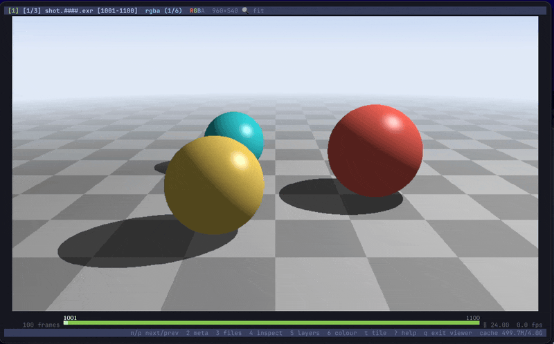

# QuickRecord

A screenshot and screen recorder that stays out of your way. Press a hotkey, pick an area,
and the result is on your clipboard.



## Features

- Record a region, window or the whole screen to GIF or MP4.
- Screenshots with drawing tools: arrows, shapes, text, highlight.
- Editor: trim, crop, caption, then Copy.
- History of everything you recorded, with the edited versions; select several to preview them playing together.
- Contact sheets from several screenshots, or several recordings playing together in one video, live as you arrange it.
- Laser pointer to circle things while you record.
- Linux (X11), macOS 13+ (Apple Silicon) and Windows 10/11 (x64).

## Usage

| Action | Linux | macOS | Windows |
| --- | --- | --- | --- |
| Start / stop recording | `Meta+Shift+R` | `⌃⇧R` | `Ctrl+Alt+Shift+R` |
| Screenshot | `Meta+Shift+S` | `⌃⇧S` | `Ctrl+Alt+Shift+S` |
| Laser pointer | `Meta+Shift+G` | `⌃⇧G` | `Ctrl+Alt+Shift+G` |

In the area picker: drag a region, click a window, or Shift+click for the full screen.
Enter reuses the last area; `H` lists all shortcuts.

It also takes commands from the terminal (`--help` for all of them):

```sh
quickrecord --toggle       # pick an area, or stop recording
quickrecord --screenshot
quickrecord --history
quickrecord --record-rect 100,80,1280,720 && quickrecord --stop   # record without any UI
```

Files go to `~/Pictures/quickrecord` and `~/Videos/quickrecord` (`~/Movies` on macOS).
Recording keys and clicks is macOS only so far.
An MP4 or MOV you put into the recordings folder, or drop on the History, joins it ready to edit.
Rename anything in the History (F2): its edited files follow, and so do future ones.

## Install

Download from [releases](https://github.com/Elyg/quickrecord/releases): the AppImage on
Linux, the `.dmg` on macOS, the `.zip` on Windows.

On macOS, install ffmpeg first (`brew install ffmpeg`). The app isn't notarized, so allow
the first launch in System Settings › Privacy & Security, or run
`xattr -dr com.apple.quarantine /Applications/QuickRecord.app`. Grant it **Screen
Recording** when asked, then restart it.

On Windows, unpack the whole zip and run `QuickRecord.exe`; ffmpeg and gifski are inside.
It isn't signed, so SmartScreen asks first: More info › Run anyway.

A [Raycast](https://raycast.com) extension is in `raycast/` (`just raycast`).

## Building

The toolchain comes from the nix flake (`direnv allow`).

```sh
just init      # deps, configure, build, run
just build
just tests
just package   # AppImage, the .dmg on macOS, the .zip on Windows
just windows-check   # cross-compile for Windows from macOS or Linux
```

Windows has no nix: with [Git for Windows](https://git-scm.com/downloads/win) and Python,
`pip install aqtinstall conan cmake ninja rust-just`, then the same `just` commands from Git
Bash fetch the rest into `.sdk/`.

## Development

Developed with assistance from [Claude Code](https://claude.com/claude-code). All changes
are reviewed, tested, and maintained by me.
