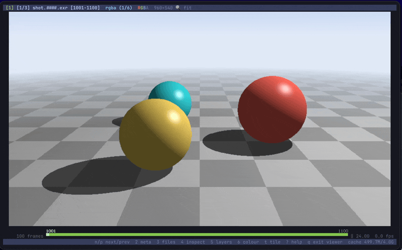

# QuickRecord

A screenshot and screen recorder that stays out of your way. Press a hotkey, pick an area,
and the result is on your clipboard.



## Features

- Record a region, window or the whole screen to GIF or MP4.
- Screenshots with drawing tools: arrows, shapes, text, highlight.
- Editor: trim, crop, caption, then Copy.
- History of everything you recorded, with the edited versions.
- Contact sheets from several screenshots.
- Laser pointer to circle things while you record.
- Linux (X11) and macOS 13+ (Apple Silicon).

## Usage

| Action | Linux | macOS |
| --- | --- | --- |
| Start / stop recording | `Meta+Shift+R` | `⌃⇧R` |
| Screenshot | `Meta+Shift+S` | `⌃⇧S` |
| Laser pointer | `Meta+Shift+G` | `⌃⇧G` |

In the area picker: drag a region, click a window, or Shift+click for the full screen.
Enter reuses the last area; `H` lists all shortcuts.

It also takes commands from the terminal (`--help` for all of them):

```sh
quickrecord --toggle       # pick an area, or stop recording
quickrecord --screenshot
quickrecord --history
quickrecord --record-rect 100,80,1280,720 && quickrecord --stop   # record without any UI
```

Files go to `~/Pictures/quickrecord` and `~/Videos/quickrecord` (`~/Movies` on macOS).

## Install

Download from [releases](https://github.com/Elyg/quickrecord/releases): the AppImage on
Linux, the `.dmg` on macOS.

On macOS, install ffmpeg first (`brew install ffmpeg`). The app isn't notarized, so allow
the first launch in System Settings › Privacy & Security, or run
`xattr -dr com.apple.quarantine /Applications/QuickRecord.app`. Grant it **Screen
Recording** when asked, then restart it.

A [Raycast](https://raycast.com) extension is in `raycast/` (`just raycast`).

## Building

The toolchain comes from the nix flake (`direnv allow`).

```sh
just init      # deps, configure, build, run
just build
just tests
just package   # AppImage, or the .dmg on macOS
```

## Development

Developed with assistance from [Claude Code](https://claude.com/claude-code). All changes
are reviewed, tested, and maintained by me.
